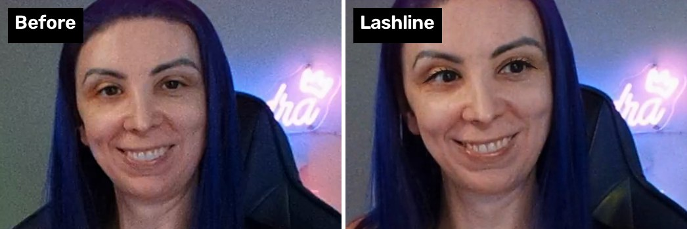

# Lashline

Eyeliner filter for OBS Studio.



A filter that draws a little winged eyeliner, with optional lashes, on your webcam, live in
OBS Studio. It tracks your face so the liner stays on your lash line as you move, blink and
turn your head.


It's a replacement for Snap Camera's eyeliner lens. It runs entirely on your computer, and
needs no account and no extra app.

## Install

You need **OBS Studio 31 or newer**. Download the file for your system from the
[Releases page](https://github.com/valheru7/lashline/releases), then follow the steps for your
system. Close OBS before installing or updating, since a running OBS keeps the old copy loaded.

So far Lashline has been tested on Windows. The macOS and Linux builds are made the same way
but haven't been tried in OBS yet; reports are welcome.

### Windows

1. Download `lashline-<version>-windows-x64.zip` and unzip it. Inside is a folder called
   `lashline`.
2. Open `C:\ProgramData\obs-studio\plugins`. ProgramData is a hidden folder, so the easiest
   way is to paste that path into File Explorer's address bar. If `obs-studio` or `plugins`
   doesn't exist yet, create it.
3. Move the `lashline` folder in there. You should end up with
   `C:\ProgramData\obs-studio\plugins\lashline\bin\64bit\lashline.dll`.

### macOS (Apple silicon)

1. Download `lashline-<version>-macos-universal.pkg`. Despite the name, it runs on Apple
   silicon Macs (M1 and later) only.
2. Open it. macOS will refuse at first, because the installer isn't signed by an Apple
   developer account. Click **Done**, then go to **System Settings → Privacy & Security**,
   scroll down, and click **Open Anyway** next to the message about Lashline.
3. Follow the installer. It puts the plugin in
   `/Library/Application Support/obs-studio/plugins`.

### Linux (Ubuntu 24.04 and similar)

1. Download `lashline-<version>-x86_64-linux-gnu.deb`.
2. Install it with `sudo apt install ./lashline-<version>-x86_64-linux-gnu.deb`.

This works with OBS installed from your distribution or the OBS PPA. It doesn't work with the
Flatpak version of OBS.

### Add it to your camera

1. Start OBS, right-click your webcam source and choose **Filters**.
2. Under **Effect Filters**, click **+** and choose **Lashline**.
3. If you use a Chroma Key, put Lashline **above** it.

If Lashline isn't in the list, OBS didn't load it. Open **Help → Log Files → Show Log Files**
and look for lines mentioning lashline.

### Use it in Zoom, Google Meet or Teams

OBS's **Virtual Camera** shows up as a webcam in other apps, so your liner comes along to
video calls.

1. In OBS, make a scene with just your webcam (with the Lashline filter), so no overlays
   or alerts end up on the call.
2. Click **Start Virtual Camera** under **Controls**, at the bottom right.
3. In the call app, choose **OBS Virtual Camera** as your camera:
   - **Zoom:** Settings → Video → Camera.
   - **Google Meet:** ⋮ → Settings → Video. If it isn't listed, restart your browser.
   - **Teams:** Settings → Devices → Camera.

Keep OBS open for the whole call; the camera goes black when it closes. Only one app can use
the real webcam at a time, so let OBS have it. Zoom's **Touch up my appearance** can fight
with the liner, so turn it off. On macOS, the first time you start the Virtual Camera, OBS
asks you to allow its system extension in **System Settings → Privacy & Security**.

## Settings

| Setting | What it does |
|---|---|
| Color | Liner color. A soft black by default; try a dark brown. |
| Opacity | How strong the liner is. |
| Thickness | Thickness at the outer corner, as a percentage of your eye's width. |
| Wing length / angle | The flick past the outer corner. Length 0 means no wing. |
| Edge softness | How soft the edges are. |
| Lashes | A few thin lashes on the outer half of each lid. |

Sizes are relative to your eyes, so the look stays the same as you lean in or out.

## How it works

1. Every frame, a downscaled copy of the webcam picture goes to a background thread.
2. There, Google's MediaPipe face models find 478 points on the face. The models are run
   through ONNX Runtime and converted to ONNX in `data/models/`. The points are smoothed from
   frame to frame (a [One Euro filter](https://gery.casiez.net/1euro/)), so the liner holds
   still when you do but keeps up when you turn or blink.
3. The upper-lid points become a smooth curve, and the liner is a band along it: thin at the
   inner corner, thicker at the outer corner, with a wing. It's drawn on the GPU with soft,
   faded edges.

The face tracking takes about 3 ms per frame on a laptop CPU, and the filter never makes
OBS's render thread wait for it.

## Build

The plugin is based on [obs-plugintemplate](https://github.com/obsproject/obs-plugintemplate),
so its build instructions apply:

```sh
cmake --preset macos        # or windows-x64, ubuntu-x86_64
cmake --build --preset macos
```

The ONNX Runtime release is downloaded during configuration.

### Checks that don't need OBS

`tests/` builds two small tools that run on video files:

- `track-video` prints the tracked points for each frame, unsmoothed unless you give it the
  frame rate. Compare them with `prototype/compare_tracker.py`.
- `render-video` draws the liner with a software renderer.

`prototype/` is the Python version that was used to design the look.

## Credits

- Face models: [MediaPipe Face Landmarker](https://ai.google.dev/edge/mediapipe/solutions/vision/face_landmarker)
  by Google, Apache License 2.0.
- [ONNX Runtime](https://onnxruntime.ai) by Microsoft, MIT License.

## License

GPL-2.0-or-later, like OBS Studio.
